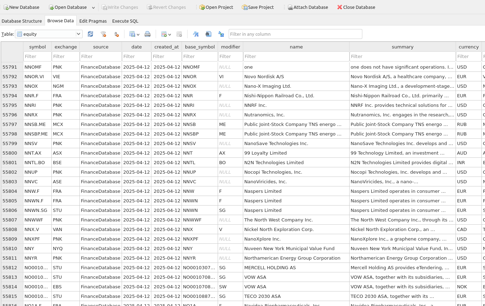
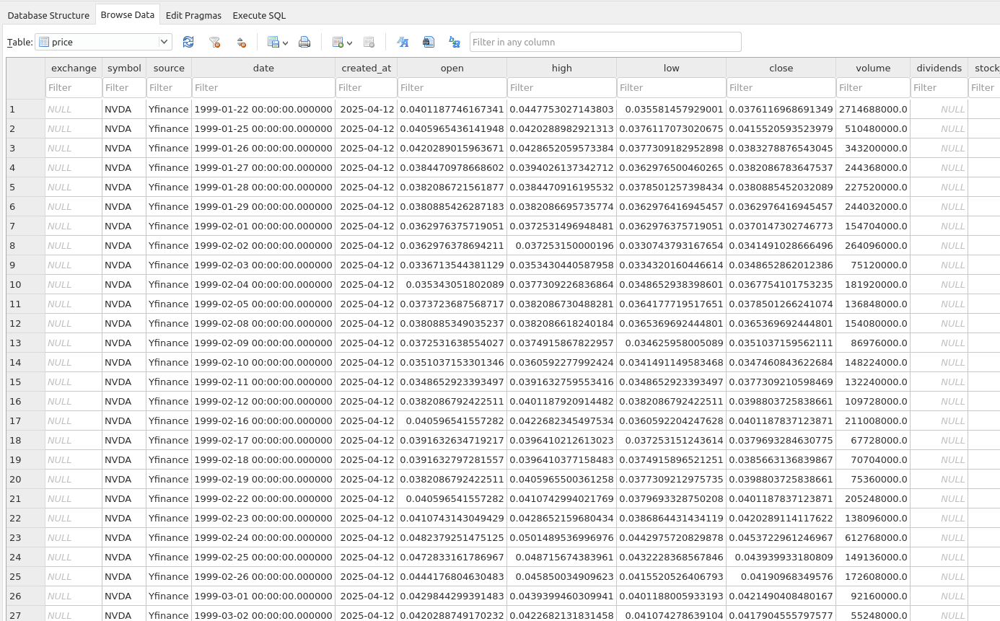
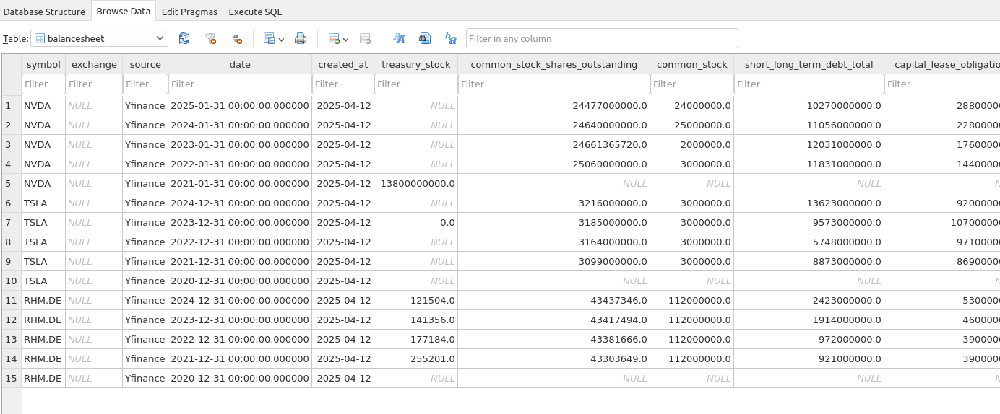

# 🐻 Bearish

**Bearish** is a package for **querying financial and price data** from various equities across different countries, and **persisting it into a well-structured SQLite database** for further data analysis and stock screening.

---

## 🎯 Use Case

This package is intended for **active retail investors** with a strong passion for **data analysis**, who require well-structured, clean, and large datasets locally to:

- Run **custom technical and fundamental analysis**
- Perform in-depth **data analysis**
- Identify patterns and investment **insights**
- Build **custom screeners**

Bearish is **not designed for real-time trading**, but for extensive analysis of historical and current financial data.

---

## 🌍 Global Scope

Bearish is designed to collect large-scale data from exchanges in different countries. It **fetches data politely** — meaning it does not make large-scale concurrent API calls and instead respects the rate limits and policies of each data provider. So, **patience is required** during large data retrieval.

The data fetched includes:

- Historical **price data**
- Company **fundamentals**
- **Balance sheets**, **income statements**, and more

All data is stored in a **local SQLite database** from which you can query, analyze, and build insights.

---

## 📊 Data Sources

Bearish pulls data from multiple sources:

- [📦 FinanceDatabase](https://github.com/JerBouma/FinanceDatabase) for basic ticker information
- [🌐 InvestPy](https://github.com/alvarobartt/investpy) for country-level equity listings
- [📉 yFinance](https://pypi.org/project/yfinance/) as the primary source of prices and fundamentals
- [📊 Financial Modeling Prep (FMP)](https://financialmodelingprep.com/)
- [🔍 AlphaVantage](https://www.alphavantage.co/)
- [📈 Tiingo](https://www.tiingo.com/)

> Ticker information is **enriched** using additional sources like yFinance, FMP, etc.  
> Bearish is also **extensible** — you can add support for any data source or API.

By default, Bearish relies primarily on **yFinance** due to limitations in free-tier APIs of other providers. However, if you have a **premium subscription**, you can use other sources more fully.

---

## 📥 Installation

Install Bearish with pip:

```bash
pip install bearishpy
```

---

## 🚀 Fetch & Store Data

### 🏛️ Country-Level Data

Fetch and store stock data for selected countries:

```bash
bearish run /path/to/sqlite/db Belgium France --api-keys=config.json
```

✅ This command:

- Loads tickers from FinanceDatabase and InvestPy
- Filters relevant equities from the selected countries
- Enriches the data with fundamentals and prices
- Stores everything in your local SQLite database

> ⏱️ This operation can take some time depending on the size of the country’s exchange — data is fetched "politely", not in bulk.

Once your database is populated, future updates are quicker.



---


The `config.json` contains the API keys of the different providers (if needed):

```json
{
  "FMPAssets": "your Financial Modeling Prep API key",
  "FMP": "your Financial Modeling Prep API key",
  "AlphaVantage": "your Alphavantage API key",
  "Tiingo": "your Tiingo API key"
}
```

---

## 🔄 Updating Data

### 💵 Update Prices

To update only the price data:

```bash
bearish prices /path/to/sqlite/db Belgium France --api-keys=config.json
```

---

### 🧾 Update Financials

To update financial and fundamental data:

```bash
bearish financials /path/to/sqlite/db Belgium France --api-keys=config.json
```

---

## 🎯 Fetch Specific Tickers

To fetch and store data for specific tickers:

```bash
bearish run /path/to/sqlite/db US --filters NVDA,TSLA,RHM.DE --api-keys=config.json
```

> You must always provide the country where each ticker is traded along with the desired tickers as filters.

---

## 📚 Summary

| Feature | Description |
|--------|-------------|
| 🌍 Country-level support | Fetch equities from any exchange |
| 🧠 Fundamental data | Balance sheets, cash flow, income statements |
| 📉 Price history | Up-to-date historical prices |
| 🗄️ Local database | Data saved in SQLite for offline analysis |
| 🔌 Extensible | Plug in your own APIs or providers |
| 🧪 Designed for analysis | Ideal for custom screeners and research |

---

## 🛠️ Contributing

Contributions are welcome! Feel free to open issues or submit pull requests to improve Bearish.

### Development

The project is managed with [uv](https://github.com/astral-sh/uv):

```bash
uv sync                                      # install dependencies
uv run pytest -m "not network and not lfs"   # offline, deterministic tests
uv run pytest                                # full suite (live APIs + git-lfs test db)
uv run ruff check                            # lint
uv run mypy                                  # type check
```

Database schema changes are managed with **Alembic** (migrations live in
`bearish/database/alembic/versions`):

```bash
uv run python -m bearish.database.scripts.create_revision   # autogenerate a revision
uv run python -m bearish.database.scripts.upgrade           # upgrade a database to head
```

---

## 📄 License

Bearish is released under the **MIT License**.